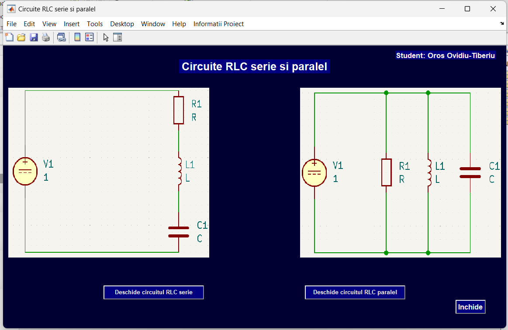
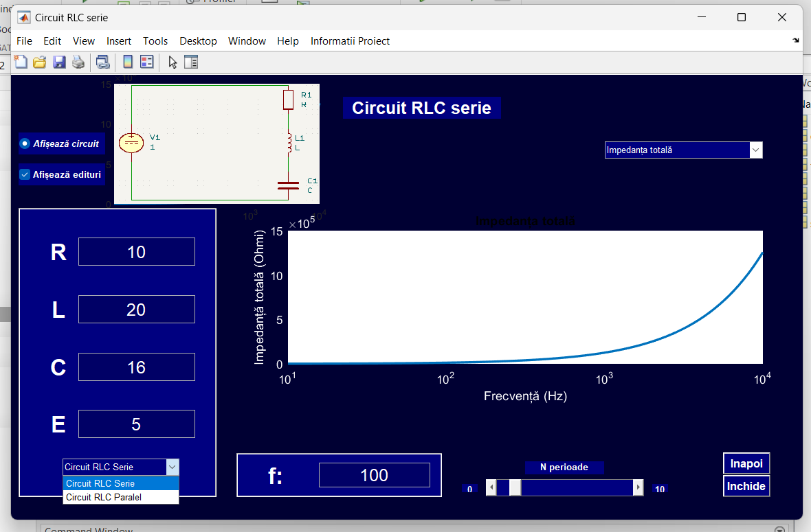
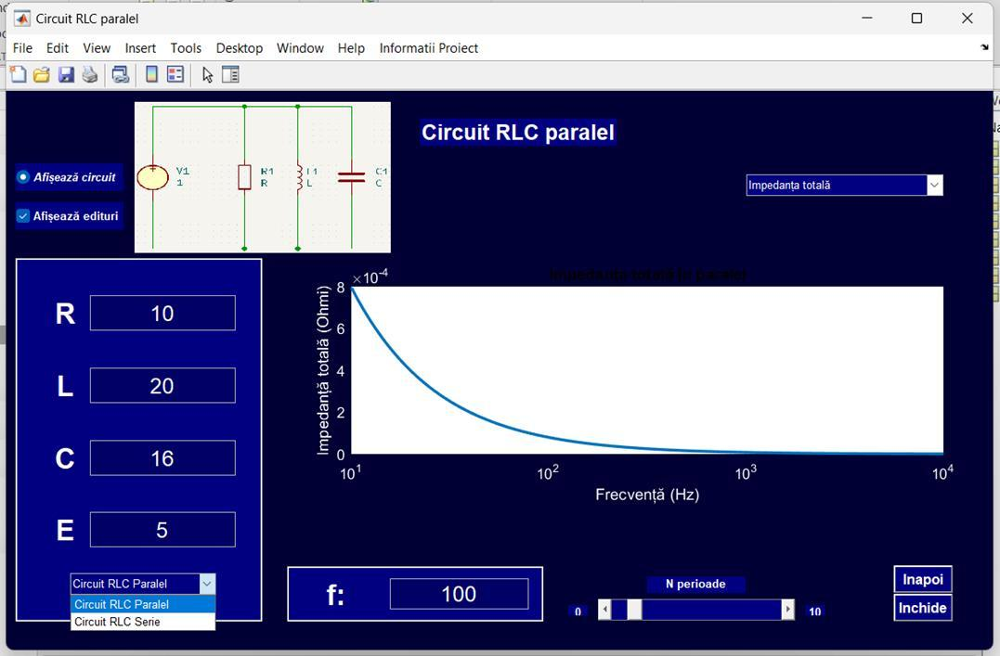

# ⚡ Series & Parallel RLC Circuits — MATLAB GUI


An interactive MATLAB application for analyzing **series** and **parallel RLC circuits**.
Change R, L, C, the source voltage and frequency, and instantly see how impedances,
currents and voltages behave — in the time domain and across frequency.

> University project for the *Computer-Aided Graphics* course (Grafică Asistată de Calculator),
> Technical University of Cluj-Napoca, 2023-2024

<p align="center">
  
</p>

---

## ✨ Features

- **Two circuit types** — series RLC and parallel RLC, each in its own window, with a quick switch between them
- **Live parameters** — edit **R**, **L**, **C**, **E** (RMS source voltage) and **f** (frequency); the plot updates on Enter
- **Number of periods slider** — show 0–10 periods of the signal
- **7 plot types** for each circuit:

  | # | Plot | Series | Parallel |
  |---|------|:------:|:--------:|
  | 1 | Resistor impedance `R` | ✅ | ✅ |
  | 2 | Inductive reactance `X_L(f)` | ✅ | ✅ |
  | 3 | Capacitive reactance `X_C(f)` | ✅ | ✅ |
  | 4 | Total impedance `|Z(f)|` | ✅ | ✅ |
  | 5 | `Z_eq`, `X_L`, `X_C` vs. frequency | ✅ | ✅ |
  | 6 | Voltages `u_R`, `u_L`, `u_C` (series) / Currents `i_R`, `i_L`, `i_C` (parallel) | ✅ | ✅ |
  | 7 | Voltage waveforms | — | ✅ |

- **Circuit diagrams** drawn in KiCad, toggled with a radio button
- **"Informații Proiect" menu** — opens the documentation (PDF / PowerPoint), author info, bibliography and image credits directly from the app

## 📸 Screenshots

| Series RLC | Parallel RLC |
|:---:|:---:|
|  |  |

## 🚀 Getting started

**Requirements:** MATLAB R2019a or newer (no extra toolboxes needed).

```bash
git clone https://github.com/ovidiuoros/Series-and-Parallel-RLC-Circuits.git
```

1. Open MATLAB and set the cloned folder as the **Current Folder**.
2. Run:
   ```matlab
   main
   ```
3. Choose **Deschide circuitul RLC serie** or **Deschide circuitul RLC paralel**.
4. Tick **Afișează edituri** to show the parameter fields, then pick a plot from the dropdown.

Default values (set in `main.m`):

| Parameter | Value | Meaning |
|---|---|---|
| `R` | 200 Ω | Resistance |
| `L` | 1 H | Inductance |
| `C` | 100 µF | Capacitance |
| `E` | 30 V | Source voltage (RMS) |
| `fr` | 16 Hz | Source frequency |
| `N` | 1 | Number of periods shown |

## 📐 Theory

Source voltage: $u(t) = \sqrt{2}\,E\,\sin(\omega t)$, with $\omega = 2\pi f$

| | Series RLC | Parallel RLC |
|---|---|---|
| Complex impedance | $Z = R + j\omega L + \dfrac{1}{j\omega C}$ | $\dfrac{1}{Z} = \dfrac{1}{R} + \dfrac{1}{j\omega L} + j\omega C$ |
| Magnitude | $\lvert Z\rvert = \sqrt{R^2 + \left(\omega L - \dfrac{1}{\omega C}\right)^2}$ | $\lvert Z\rvert = \dfrac{1}{\sqrt{\left(\dfrac{1}{R}\right)^2 + \left(\omega C - \dfrac{1}{\omega L}\right)^2}}$ |
| At resonance | $\lvert Z\rvert$ is **minimum** ($= R$) | $\lvert Z\rvert$ is **maximum** ($= R$) |

Reactances: $X_L = \omega L$, $X_C = \dfrac{1}{\omega C}$ — Resonant frequency: $f_0 = \dfrac{1}{2\pi\sqrt{LC}}$

## 🗂️ Project structure

```
├── main.m                    # Entry point – sets default values, opens the main window
├── interfata.m               # Main menu window
├── serie.m                   # Series RLC window (controls + layout)
├── paralel.m                 # Parallel RLC window (controls + layout)
├── afisaregraficserie.m      # Plots for the series circuit
├── afisaregraficparalel.m    # Plots for the parallel circuit
├── afisarecircuitserie.m     # Shows / hides the series diagram
├── afisarecircuitparalel.m   # Shows / hides the parallel diagram
├── selectCircuit.m           # Switch series → parallel
├── selectCircuit2.m          # Switch parallel → series
├── circuitserie.png          # Series diagram (KiCad)
├── circuitparalel.png        # Parallel diagram (KiCad)
├── fundal.png                # Blank background image
├── Documentatie_*.pdf/.pptx  # Project documentation (Romanian)
├── bibliografie.pdf          # Bibliography
├── autorproiectGAC.pdf       # Author info
├── imagini.pdf               # Image credits
└── docs/screenshots/         # Images used in this README
```

## 📚 References

- *Grafică Asistată de Calculator* course — As. dr. ing. Adrian Tăut
- *Dispozitive Electronice* course — Prof. dr. ing. Ovidiu Pop
- [lectii-virtuale.ro — RLC series and parallel circuits](https://lectii-virtuale.ro/teorie/circuitele-rlc-serie-si-paralel-impedanta-diagrama-fazoriala)
- Circuit diagrams made with [KiCad](https://www.kicad.org/)

Full bibliography: [`bibliografie.pdf`](bibliografie.pdf)

## 👤 Author

**Ovidiu-Tiberiu Oros** — Technical University of Cluj-Napoca
